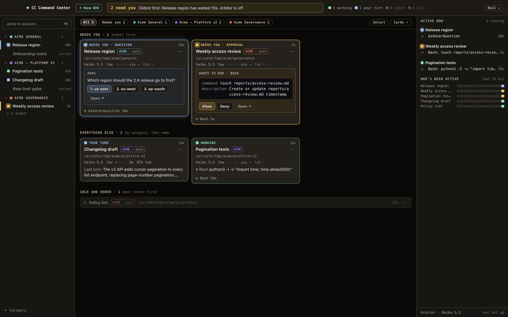
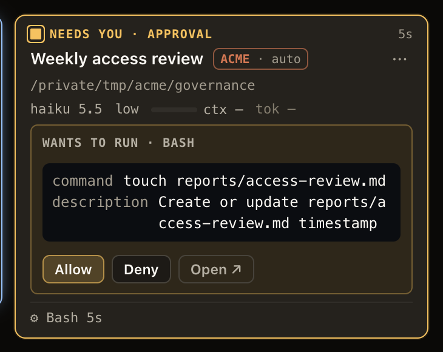
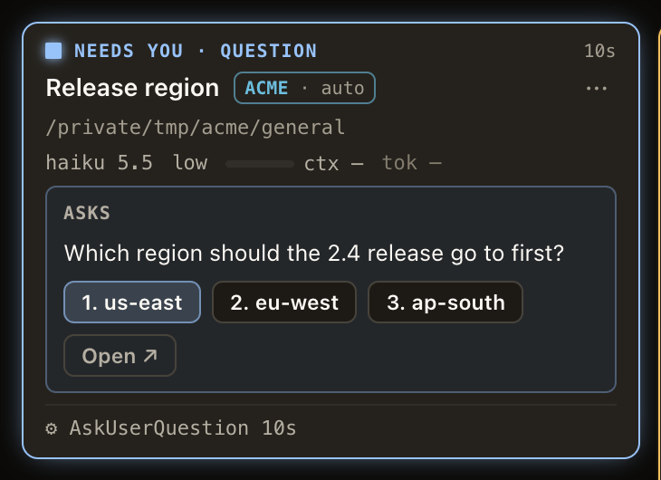
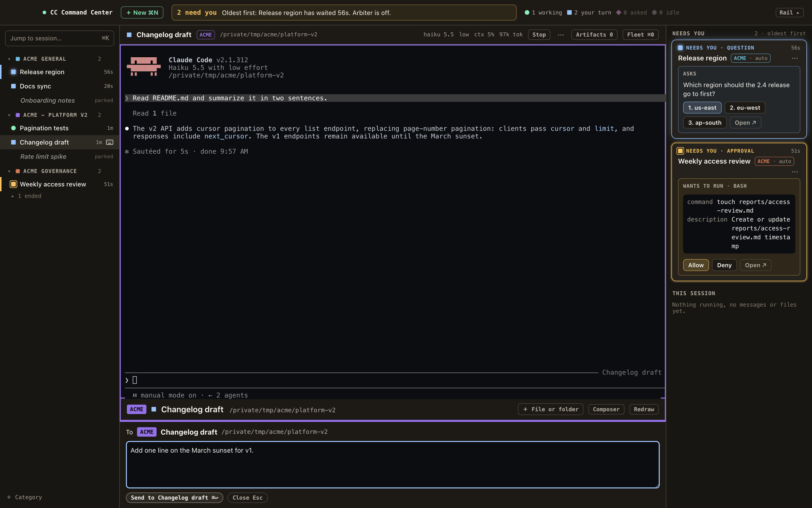

# CC Command Center

A macOS app for running many Claude Code sessions at once. It shows every background session in one window, says which ones need you and why, and lets you answer permission prompts, send prompts and open a session's terminal without leaving the app.

This is the successor to CC Command Center 0.24, rebuilt on Claude Code's own background sessions.



> **Disclaimer.** This app depends on Claude Code, which changes often. Each release is tested against a stated Claude Code version (see Requirements). A newer Claude Code version can break features until the app is updated. The app checks the Claude Code version when it starts and turns off any feature it can't verify on that version, and the parts it can't read show as out of date. The app is provided as is, with no warranty. It is an independent project and is not affiliated with or endorsed by Anthropic. "Claude" and "Claude Code" are Anthropic's names. Report problems at [github.com/avanrossum/cc-command-center/issues](https://github.com/avanrossum/cc-command-center/issues).

## Requirements

- macOS on Apple Silicon (arm64).
- Claude Code 2.1.311 or later, installed and signed in. Releases are tested against 2.1.311. Below that version the app shows sessions but starts, opens and answers nothing.
- For the optional card summaries and the Arbiter: an Anthropic API key, billed to you at API rates.

## Install

Releases are published at [Releases](https://github.com/avanrossum/cc-command-center/releases) as a disk image: open it and drag the app to Applications. Until the first release is published, build it from source (below).

## What it does

- **Fleet.** Every session as a card, grouped by category, with what it's doing, whether it needs you, and its model, effort and context use.
- **Needs you.** A session waiting on a permission prompt or a question says so on its card. You can answer it from the card when the whole request fits on screen, or open the session.
- **Focus.** A session's terminal in the app, with a composer for sending prompts.

<p>
  
  
</p>



- **Categories.** Sessions sort themselves into categories by folder. You can also place them by hand.
- **Launch, resume, stop.** Sessions run as Claude Code background sessions, so they keep running when the app quits.
- **Security checks.** Each session talks to the app over its own private channel. The app watches that channel and its reporter mod for changes, and shows an alert you can't dismiss when something it relies on was changed.

## How it differs from 0.24

- **Sessions belong to Claude Code.** 0.24 ran each session in its own terminal process. This app uses Claude Code's background sessions and its supervisor, so sessions survive the app quitting and can be reached from the `claude` command line too.
- **It reads Claude Code through documented interfaces.** Session state comes from `claude agents --json` and a small reporter mod that each session loads. When an interface changes, the affected fields show as out of date instead of being guessed.
- **It moves 0.24's sessions in.** Settings, categories and session names import from 0.24. Running and parked 0.24 sessions can be moved in from the move sheet, keeping their conversations. 0.24's own data is only read.
- **No dictation.** 0.24's microphone feature isn't part of this app.

## Building from source

```sh
npm install
npm run setup     # once, after npm install
npm run check     # type check and tests
npm run package   # an ad-hoc signed app in release/
```

`docs/release-plan.md` describes how releases are built, signed and published, and how 0.24 is kept away from them.

## License

Apache License 2.0. See `LICENSE`.
